# Autorregistro de usuários via Perun no SATOSA

Este repositório reúne a configuração do proxy SATOSA do Core AAI Platform para o **autorregistro de usuários**: no primeiro acesso, o usuário que faz login com sua instituição ganha uma conta no Perun e é levado a pedir entrada na VO exigida pelo serviço.

O fluxo é baseado no registro do **my-eurohpc** (MyAccessID + Perun Registrar), adaptado para a federação CAFe.

## 1. O fluxo do ponto de vista do usuário

1. O usuário acessa a aplicação e clica em **Entrar**.
2. É levado ao WAYF da CAFe Expresso e escolhe sua instituição.
3. Faz login no IdP da instituição.
4. No primeiro acesso, o proxy cria automaticamente sua conta no Perun. Esse passo é invisível para o usuário.
5. O proxy verifica se ele é membro da VO exigida pela aplicação. Se ainda não for, ele é redirecionado ao **formulário de cadastro do Perun Registrar** (`signup.local`).
6. O usuário preenche e envia o formulário de entrada na VO.
7. A solicitação é aprovada, automaticamente ou por um gestor, conforme a configuração da VO no Perun.
8. O usuário volta à aplicação e faz login de novo. Agora ele é membro da VO e o acesso é liberado.

Nos próximos acessos, só os passos 1, 2, 3 e 8 acontecem.

## 2. Status da configuração

### Funcionando

- Login via CAFe Expresso (WAYF + IdP institucional) pelos frontends OIDC e SAML.
- Identificador persistente do usuário (CUID) gerado pelo cuidapp e entregue ao serviço como `sub` (OIDC) e `voPersonID` (SAML).
- Criação automática da conta no Perun no primeiro acesso (VO "Account Registry").
- Leitura de atributos e grupos do usuário no Perun.
- Conversão dos grupos em entitlements no formato AARC-G069.
- Bloqueio da aplicação para quem não é membro da VO, com redirecionamento ao Registrar.
- Acesso ao próprio Registrar sem exigir VO.
- Envio do `sourceIdPEntityID` ao SP do Perun.

### Pendente

- **Login com múltiplos IdPs.** O `source-idp-entityid` e o `attribute_store` estão fixos no IdP4 da CAFe Expresso. Usuários de outros IdPs não são encontrados no Perun.
- **Retomar o login após o cadastro.** Depois do formulário, o usuário vai para uma URL fixa (`targetnew=http://localhost:9999/`) e precisa entrar de novo. No my-eurohpc, o login original é retomado automaticamente.
- **Redirecionamento por serviço.** O `error_url` do `access_per_vo` tem a VO `teste` fixa. Todo acesso negado leva ao formulário dessa VO.
- **Requisitos de acesso.** Só o `testclient` tem VO exigida. Serviços que não estão em `service_access_requirements` nem na skiplist são sempre bloqueados.
- **Entitlements para os serviços.** `groups` e `entitlements` não estão em `internal_attributes.yaml`, então não chegam às aplicações.
- **Páginas de erro.** `accounts` e `attribute_store` apontam para `https://localhost:8000/error`.
- **CUID por e-mail.** Se o e-mail mudar no IdP, o usuário pode receber outro CUID e ganhar uma conta nova no Perun.
- **Produção.** Ainda é preciso definir o namespace AARC (hoje `urn:geant:core-aai.local`), assinar os AuthnRequests, desligar `allow_unsolicited`, ajustar os contatos do metadata e reduzir o log de DEBUG.

## 3. Plugins utilizados

```mermaid
flowchart LR
    subgraph REQ["Requisição (antes do login)"]
        M1["<b>metainfo</b>"]
    end

    subgraph RES["Resposta (depois do login)"]
        M2["<b>metainfo-issuer</b>"]
        S["<b>source-idp-entityid</b>"]
        A["<b>cuid</b>"]
        B["<b>accounts</b>"]
        C["<b>attribute_store</b>"]
        D["<b>aarc_group_role_processor</b>"]
        E["<b>access_per_vo</b>"]
    end

    IDP(["IdP da instituição"])
    REG(["Perun Registrar"])
    APP(["Aplicação"])

    M1 --> IDP --> M2 --> S --> A
    A -- "cuid" --> B
    B -- "conta no Perun" --> C
    C -- "atributos + groups" --> D
    D -- "entitlements" --> E
    M1 -. "nome do serviço" .-> E
    E -- "membro da VO" --> APP
    E -- "não é membro" --> REG
```

| Plugin | Arquivo | O que faz |
|---|---|---|
| metainfo | `metainfo.yaml` | Na requisição, guarda o nome do serviço que pediu o login. O `access_per_vo` usa esse nome na página de erro. |
| metainfo-issuer | `metainfo-issuer.yaml` | Na resposta, guarda o nome e a autoridade de registro do IdP. |
| source-idp-entityid | `source-idp-entityid.yaml` | Grava o entityID do IdP de origem em `sourceIdPEntityID`, atributo exigido pelo SP do Perun. O valor é fixo para cada IdP. |
| cuid | `cuid.yaml` | Chama o cuidapp com o `mail` do IdP e grava o identificador persistente no atributo `cuid`. |
| accounts | `accounts.yaml` | Procura o usuário no Perun. Se não existir, cria o usuário e o membro da VO "Account Registry" e grava o CUID (UES = IdP de origem + CUID). |
| attribute_store | `attribute-store.yaml` | Busca o usuário no Perun por ExtSource + CUID e preenche `mail`, `displayname`, `givenname`, `surname` e `groups`. |
| aarc_group_role_processor | `aarc-group-role-processor.yaml` | Converte `groups` em `entitlements` no formato AARC-G069. Exemplo: `OrgT` vira `urn:geant:core-aai.local:group:OrgT`. |
| access_per_vo | `access-per-vo.yaml` | Libera o acesso se algum entitlement atende ao requisito de VO do serviço. Se não atende, redireciona ao Perun Registrar. |
| healthcheck | `healthcheck.yaml` | Expõe `GET /healthcheck` para sondas de disponibilidade. Não participa do login. |

A ordem dos plugins em `proxy_conf.yaml` importa:

- `metainfo` precisa vir antes de `access_per_vo`.
- `cuid` precisa vir antes de `accounts` e `attribute_store`.
- `aarc_group_role_processor` precisa vir antes de `access_per_vo`.

### Variáveis de ambiente

| Variável | Uso |
|---|---|
| `BASE` | URL pública do proxy |
| `STATE_ENCRYPTION_KEY` | Cifra do cookie de estado |
| `OIDC_DB_URI`, `OIDC_TOKEN_ENCRYPTION_PASSWORD` | Frontend OIDC |
| `CUID_ACCESS_TOKEN` | API do cuidapp |
| `PERUN_API_URL`, `PERUN_API_USER`, `PERUN_API_PASSWORD` | API RPC do Perun |
| `PERUN_VO_ID` | ID da VO "Account Registry" |

## 4. Configurações no Perun

Estas configurações ficam no banco do Perun, não neste repositório. Se a instância for recriada, elas precisam ser refeitas.

### 4.1 Acesso à API

- **Usuário de API** (`PERUN_API_USER`) com permissão para criar ExtSources, criar membros na VO "Account Registry" e ler/gravar atributos de usuários e de UES. No ambiente local foi usado o usuário `perun`.
- **URL da API RPC** (`PERUN_API_URL`) terminando em `/ba/rpc/json/`. Sem o `json/`, o Perun responde `400 INVALID_URL`.
- **Certificado TLS.** Se o certificado do Perun não for de uma CA pública, coloque a CA em `docker/etc/certs/`. O `entrypoint.sh` a adiciona ao bundle de CAs.

### 4.2 Atributos

Crie com `attributesManager/createAttribute` os atributos que ainda não existirem:

| Atributo | Tipo | Uso |
|---|---|---|
| `urn:perun:user:attribute-def:def:login-namespace:geant-core-aai-persistent-shadow` | `String` | CUID do usuário. Gravado pelo `accounts`. |
| `urn:perun:ues:attribute-def:def:iuids` | `ArrayList` | CUID na UES. O `accounts` busca o usuário por ele. Precisa ser **único** (`convertAttributeToUnique`). |
| `urn:perun:ues:attribute-def:def:affiliation` | `String` | Afiliação (ePSA) vinda do IdP. |
| `urn:perun:user:attribute-def:def:preferredMail` | `String` | E-mail. Gravado pelo `accounts` e lido pelo `attribute_store`. |
| `urn:perun:user:attribute-def:core:displayName`, `firstName`, `lastName` | nativos | Lidos pelo `attribute_store`. |
| `urn:perun:user:attribute-def:virt:groupNames` | virtual | Grupos do usuário, que viram entitlements. |
| `urn:perun:user:attribute-def:def:userActive:geant-core-aai` | `String` | Opcional. Só é usado com `enable_extensions_activate_user: true`. |

### 4.3 VOs e grupos

- **VO "Account Registry"** (nome curto `registry`). O ID dela vai em `PERUN_VO_ID`. Ela não precisa de formulário, porque o `accounts` cria os membros diretamente com status `VALID`.
- **VO exigida pelo serviço** (hoje `teste`):
  - Precisa de um formulário de inscrição no Registrar.
  - Defina se a aprovação é automática ou manual.
  - Confira o valor que o `groupNames` retorna para os membros dela. Esse valor vira o entitlement e precisa casar com o requisito do `access-per-vo.yaml`: `teste` → `urn:geant:core-aai.local:group:teste`.

### 4.4 ExtSource

O `accounts` cria a ExtSource automaticamente, com o entityID do IdP como nome. Não é preciso criá-la à mão, mas o mesmo nome precisa aparecer em três lugares:

- na ExtSource criada pelo `accounts`;
- em `ext_source_name`, no `attribute-store.yaml`;
- no valor de `sourceIdPEntityID`, no `source-idp-entityid.yaml`.

### 4.5 Registrar (`signup.local`)

- **Confiança mútua entre o SP do Registrar e o SATOSA:**
  - o SP do Registrar deve confiar no metadata do IdP do SATOSA (`<base_url>/Saml2IDP/proxy.xml`);
  - o metadata do SP do Registrar deve estar em `metadata/perun-sp-metadata.xml`, no SATOSA.
- **Mesma identidade criada pelo `accounts`.** O Registrar precisa reconhecer o usuário pela UES criada no primeiro acesso: ExtSource = `sourceIdPEntityID` e login = CUID (`voPersonID`). Se não reconhecer, o Registrar cria um segundo usuário no Perun.
- **Mapa de atributos do Shibboleth SP.** O `attribute-map.xml` precisa mapear `urn:cesnet:proxyidp:attribute:sourceIdPEntityID`, `voPersonID` e `mail` (`urn:oid:0.9.2342.19200300.100.1.3`).
